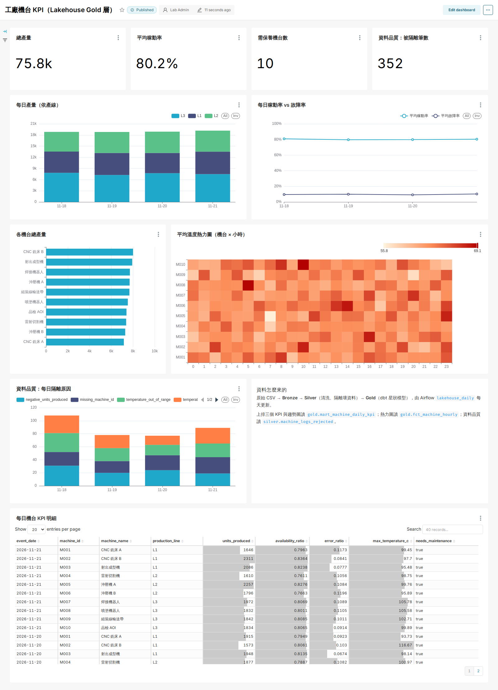
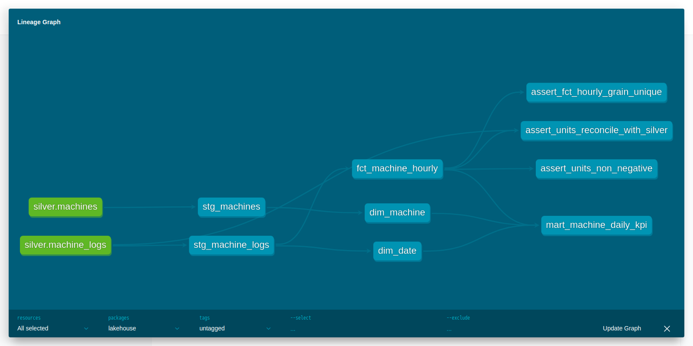
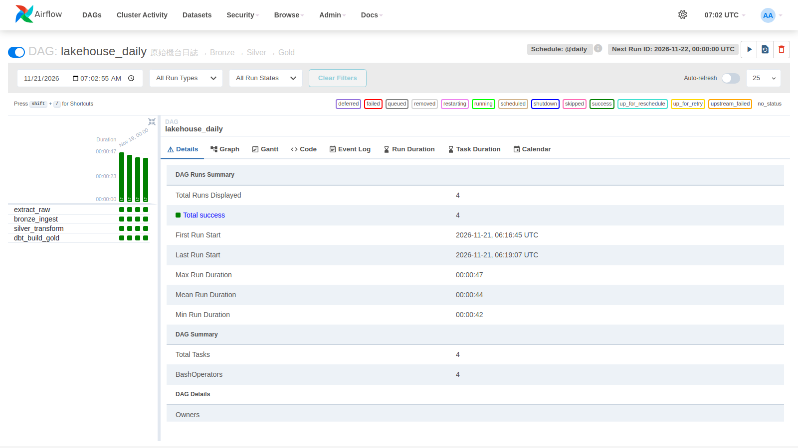

# 本地 Lakehouse 實驗室

在一台筆電上（WSL2 + Docker）跑通完整的現代資料平台：從原始機台日誌到 BI 儀表板，架構與 AWS 上的 S3 + Glue Catalog + EMR + MWAA + QuickSight 一一對應，不需要任何雲端費用。

```text
原始 CSV ─▶ Bronze ─▶ Silver ─▶ Gold ─▶ Superset 儀表板
  (模擬)    原樣保存   清洗/隔離   星狀模型
              └──────── Airflow 每日排程 ────────┘
```

## 成果截圖

**Superset 儀表板**：產量、稼動率、各機台溫度熱力圖，以及 Silver 層擋下的壞資料統計



**dbt lineage graph**：從 Silver（綠色）到 Gold 星狀模型，以及掛在模型後面的自訂測試



**Airflow Grid**：`extract_raw → bronze_ingest → silver_transform → dbt_build_gold`，四天 backfill 全部成功



> 截圖可以用 `scripts/take_screenshots.py` 重新產生（在 Playwright 容器裡執行，指令寫在檔案開頭）。

## 元件

| 元件 | 角色 | 雲端對應 | Port |
|---|---|---|---|
| RustFS（服務名 `s3`） | 物件儲存，放 Parquet 與 Iceberg metadata | S3 | 9000 / 9001 |
| Iceberg REST Catalog | 記錄每張表目前指向哪一份 metadata | Glue Data Catalog | 8181 |
| Spark + Iceberg | 運算引擎；Thrift Server 供 dbt / Superset 連線 | EMR / Glue Job | 10000 / 18080 |
| dbt | 用 SQL 建 Gold 層並做資料品質測試 | dbt Core / Cloud | — |
| Airflow | 排程與任務依賴 | MWAA | 8080 |
| Superset | BI 儀表板 | QuickSight | 8088 |

> MinIO 已停止發布 Docker 映像檔，因此改用同樣相容 S3 API 的 RustFS。

## 快速開始

```bash
cp .env.example .env                 # 依需要調整 HOST_UID / DOCKER_GID
docker compose up -d --build         # 第一次會下載數 GB 的映像檔
```

接著到 Airflow（http://localhost:8080，admin / admin）啟用 `lakehouse_daily`，或一次補跑多天：

```bash
docker exec airflow airflow dags backfill lakehouse_daily -s 2026-11-18 -e 2026-11-21
```

建立儀表板：

```bash
python3 superset/setup_dashboard.py  # 之後打開 http://localhost:8088/superset/dashboard/factory-kpi/
```

## 專案結構

```text
scripts/generate_data.py        模擬 10 台機台的感測器日誌，刻意混入 7 種髒資料
spark/jobs/bronze_ingest.py     CSV → bronze.*（全部存字串＋血緣欄位，依批次日期覆寫）
spark/jobs/silver_transform.py  bronze → silver.*（轉型、品質規則、去重、MERGE、隔離壞資料）
dbt_project/                    silver → gold.*（dim_machine、dim_date、fct_machine_hourly、mart）
airflow/dags/lakehouse_daily.py extract → bronze → silver → dbt build
superset/setup_dashboard.py     用 REST API 建立儀表板（Dashboard as Code）
```

## 設計重點

- **Bronze 不做任何修改**：清洗規則寫錯時，可以從 Bronze 重算，不需要回頭找來源系統。
- **壞資料隔離而不是丟棄**：`silver.machine_logs_rejected` 會記錄每一筆的被拒原因。
- **冪等性**：Bronze 用 `overwritePartitions()`；Silver 用 `MERGE`，並加上 `WHEN NOT MATCHED BY SOURCE AND _batch_date = ... THEN DELETE`。這樣規則變嚴格之後重跑，也能清掉以前被放行的壞資料。
- **來源可以重現**：產生器用「seed＋日期」作為種子，同一天重跑會得到完全相同的資料，backfill 因此才有意義。
- **測試就是關卡**：`dbt build` 會跑 22 項測試，其中包含 Gold 與 Silver 的產量對帳；測試沒過，下游就不會更新。

## 過程中解決的問題

| 現象 | 原因 | 解法 |
|---|---|---|
| Spark 寫 S3 時找不到主機 | S3 預設用 virtual-host 寫法（`bucket.host`） | Spark 與 REST 兩邊都設定 path-style access |
| `spark-sql` 噴出 Derby `metastore_db` 錯誤 | Thrift Server 已經占用同一目錄下的 Derby | 換到新的工作目錄再執行 |
| dbt 只顯示 `failed to connect` | Thrift 每個 session 都會執行 `USE default`，但 catalog 裡沒有這個 namespace | 建立 `default` namespace；用 PyHive 直接連線才找到原因 |
| 規則變嚴格後，壞資料仍留在 Silver | `MERGE` 只會新增和更新，不會刪除 | 加上 `NOT MATCHED BY SOURCE ... DELETE` |
| Airflow 寫不進 `dbt_project/logs` | 先前用 root 執行 dbt，產生了 root 擁有的檔案 | 所有容器都以宿主 UID 執行 |
| 排程跑的是 11-20，不是 11-21 | `@daily` 會在區間「結束後」才執行 | 理解 logical date（`{{ ds }}`） |
| Superset 熱力圖用 API 驗證正常，但瀏覽器上報 `UNRESOLVED_COLUMN` | 前端組 SQL 時，ad-hoc 運算式 `hour(...)` 在 SELECT 裡出現兩次，產生同名欄位 | 改用虛擬資料集，先算好 `hour_of_day`；截圖腳本也會在偵測到圖表錯誤時中止 |

## 已知限制（學習環境）

帳密寫在 `.env` 與設定檔中、Thrift 沒有驗證、Airflow 直接掛載 `docker.sock`、所有服務都是單一容器且使用 SQLite。這些在正式環境都必須改掉：改用機密管理、啟用驗證、拆分服務並使用 Postgres。另外，Silver 的 `MERGE` 在 Copy-on-Write 模式下會重寫整張表，資料量大時應改用 Merge-on-Read 或 incremental 模型。
